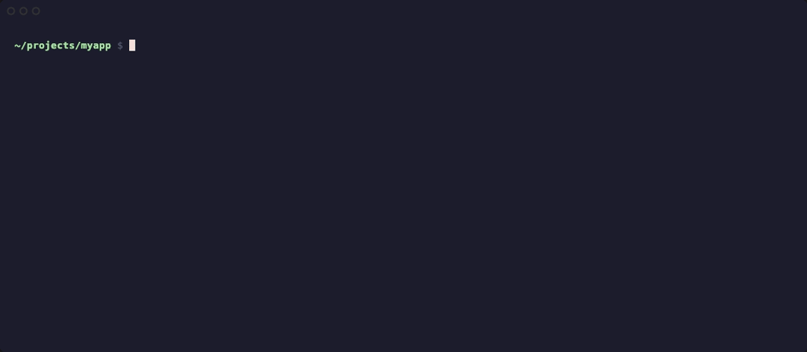

# Gru

[](https://github.com/fotoetienne/gru/actions/workflows/ci.yml)
[](LICENSE)
[](https://fotoetienne.github.io/gru/)

**File a GitHub issue. Gru turns it into a merged PR.**

Gru Lab is a local daemon that watches your repos for issues labeled `gru:todo`. For each one it spawns a Minion, a coding agent in its own git worktree, which implements the change, opens a PR, fixes CI failures, answers review comments, and rebases until the PR is ready to merge. You stay in GitHub, or in whatever LLM session you were already using to think through the work.



Gru is **agent-agnostic**. It ships with backends for [Claude Code](https://github.com/anthropics/claude-code), [OpenAI Codex](https://github.com/openai/codex), and [Pi](https://github.com/earendil-works/pi-mono), and its pluggable architecture makes it straightforward to add more.

## The Workflow

1. **Talk it through.** Work out the problem in a chat with Claude Code, Codex, or any agent that can run `gh`.
2. **File issues.** Ask the agent to file one or more GitHub issues labeled `gru:todo`. For multi-step work, ask it to set blocked-by relationships so Minions pick the issues up in order.
3. **Let the Lab run.** `gru lab` claims each unblocked issue and works it to a PR. When a PR merges and closes its issue, the next issue in the chain becomes eligible.

```
you + an LLM ──▶ issues labeled gru:todo ──▶ gru lab ──▶ Minions ──▶ PRs ──▶ merged
```

## What a Minion Does

Each issue gets its own Minion, which carries the work from issue to merge:

- **Implements and tests** the change in an isolated git worktree, so your own checkout is never touched
- **Reviews its own work** with a code-reviewer subagent before opening the PR, then posts a review on the PR and addresses what it finds
- **Fixes CI failures** by feeding the logs back to the agent (up to 2 attempts before escalating)
- **Responds to review comments** from you or anyone else on the PR
- **Rebases and resolves merge conflicts** when the base branch moves
- **Merges** when the PR is labeled `gru:auto-merge` and an LLM merge judge decides it's safe; otherwise it waits for you

## 🚀 Quick Start

```bash
# Install (macOS Apple Silicon — see Installation for other platforms)
curl -fL https://github.com/fotoetienne/gru/releases/latest/download/gru-aarch64-apple-darwin.tar.gz | tar xz
sudo mv gru /usr/local/bin/

# Initialize a repo: creates a bare mirror and the gru:* labels
gru init owner/repo

# Start the Lab
gru lab --repos owner/repo
```

`gru lab` runs in the foreground. Leave it running, and from another terminal or GitHub, hand it work: ask your agent to file an issue labeled `gru:todo`, or add the label to an existing issue.

## 🧪 Lab Mode

The Lab polls each configured repo, claims `gru:todo` issues, and runs up to `max_slots` Minions at once. Put your repos in `~/.gru/config.toml` and run `gru lab` with no arguments:

```toml
[daemon]
repos = ["owner/frontend", "owner/backend"]
max_slots = 4            # default is 2
```

While it runs, the Lab:

- **Respects dependencies.** An issue with open blockers is skipped until they close. Blockers come from GitHub's native issue dependencies (see [Filing issues](#filing-issues-from-an-llm-session) for the fallback when that API isn't available).
- **Wakes Minions up.** New reviews or merge conflicts on a PR whose Minion has already exited bring it back to respond or rebase.
- **Merges when told to.** Put `gru:auto-merge` on the issue before the Lab picks it up, or on the PR once it exists. A Minion reads the issue's labels when it starts, so adding the label to the issue mid-run has no effect. While a Minion is monitoring the PR, it merges once checks pass and an LLM merge judge clears it; if the judge isn't confident, the PR gets `gru:needs-human-review` instead. If no Minion is monitoring the PR anymore, the Lab's periodic sweep queues the merge on readiness checks alone, without the judge.
- **Survives restarts.** Minions keep running if the Lab stops. On startup the Lab resumes interrupted Minions and resets issues left orphaned in `gru:in-progress`.
- **Stops instead of looping.** When CI fixes run out, or an issue keeps getting stuck, it's labeled `gru:blocked`. A Minion that crashes or runs out of resume attempts marks its issue `gru:failed`. After 5 rounds of review feedback or 2 failed rebases, the Minion stops watching the PR without changing labels, and the PR waits for you.

### Labels

| Label | Meaning |
|---|---|
| `gru:todo` | Ready for a Minion to pick up |
| `gru:in-progress` | Claimed by a Minion |
| `gru:done` | PR opened; the Minion keeps monitoring it |
| `gru:failed` | The Minion hit a failure |
| `gru:blocked` | Needs a human |
| `gru:auto-merge` | Merge the PR automatically when it's ready |
| `gru:ready-to-merge` | All merge-readiness checks pass |
| `gru:needs-human-review` | The merge judge wants a human to look |

### Filing issues from an LLM session

You don't need to write issues by hand. Any agent that can run `gh` can file them; ask at the end of a planning conversation:

> File this as three GitHub issues in owner/repo, labeled `gru:todo`. The API change goes first; the CLI and docs issues are each blocked by it.

Ask the agent to use GitHub's native blocked-by relationship. If it needs a hint, this is the call (it takes the blocker's internal issue ID, not its number):

```bash
gh api repos/owner/repo/issues/102/dependencies/blocked_by \
  -F issue_id="$(gh api repos/owner/repo/issues/101 --jq .id)"
```

On GitHub Enterprise Server versions without the dependencies API, Gru falls back to a `**Blocked by:** #101, #102` line in the issue body (one line, `#` prefixes required, cross-repo references ignored). When the native API is available, the body line is ignored. On the fallback path Gru doesn't check whether the listed issues are closed, so remove the line once the blockers are done.

## 👀 Watching Minions

Each agent session is a "Minion." Track and control them with:

```bash
gru status              # List all active Minions
gru status M001         # Details for a specific Minion
gru logs M001           # View event stream
gru attach M001         # Attach terminal to a running Minion
gru stop M001           # Stop a running Minion
gru resume M001         # Resume a stopped Minion
gru rebase M001         # Rebase a Minion's branch onto latest base
gru path M001           # Print the Minion's worktree path
gru clean               # Remove worktrees for merged/closed PRs
```

```
MINION AGENT  REPO       ISSUE TASK PR  BRANCH               MODE                 UPTIME TOKENS
M001   claude owner/repo #42   do   #43 minion/issue-42-M001 running (autonomous) 5h     68 in / 16.1k out
M002   codex  owner/repo #44   do   -   minion/issue-44-M002 running (autonomous) 2m     -
```

### MCP Server

Gru can run as an MCP server, so the same LLM session you file issues from can check on the Minions working them:

```bash
gru mcp install      # Register in ~/.claude.json
gru mcp uninstall    # Remove from ~/.claude.json
gru mcp              # Start the stdio server (invoked by Claude)
```

Once installed, Claude Code sessions can query Minion status, read Minion logs, and look up Gru guides without leaving the conversation.

## 📦 Installation

### Prerequisites

- [GitHub CLI](https://cli.github.com/) (`gh`), authenticated
- At least one agent backend:
  - [Claude Code](https://github.com/anthropics/claude-code) (default) — `npm install -g @anthropic-ai/claude-code`
  - [OpenAI Codex](https://github.com/openai/codex) (optional) — `npm install -g @openai/codex`
  - [Pi](https://github.com/earendil-works/pi-mono) (optional) — see [docs/AGENTS.md](docs/AGENTS.md)

### Download a Prebuilt Binary

Grab the latest release from [GitHub Releases](https://github.com/fotoetienne/gru/releases/latest):

```bash
# Set target: aarch64-apple-darwin, x86_64-apple-darwin, or x86_64-unknown-linux-gnu
TARGET=aarch64-apple-darwin

# Download binary and checksum
curl -fLO "https://github.com/fotoetienne/gru/releases/latest/download/gru-${TARGET}.tar.gz"
curl -fLO "https://github.com/fotoetienne/gru/releases/latest/download/gru-${TARGET}.tar.gz.sha256"

# Verify checksum
sha256sum --check "gru-${TARGET}.tar.gz.sha256" 2>/dev/null \
  || shasum -a 256 --check "gru-${TARGET}.tar.gz.sha256"

# Install
tar xzf "gru-${TARGET}.tar.gz"
sudo mv gru /usr/local/bin/
```

### Install from Source

Requires [Rust](https://rustup.rs/) 1.73 or later.

```bash
git clone https://github.com/fotoetienne/gru.git
cd gru
cargo install --path .
```

The `gru` binary is installed to `~/.cargo/bin/gru`. Make sure `~/.cargo/bin` is on your `$PATH`.

For a detailed walkthrough, see [docs/GETTING_STARTED.md](docs/GETTING_STARTED.md).

## 🛠️ Other Commands

### Run a single issue

`gru do` runs one Minion outside the Lab. The Minion goes through the same lifecycle (worktree, PR, CI, reviews) as a background worker, and `gru do` streams its progress to your terminal. Ctrl-C only stops the stream; use `gru stop <id>` to stop the Minion.

```bash
gru do 42                                        # By issue number (from within the repo)
gru do https://github.com/owner/repo/issues/42   # By URL (from anywhere)
gru do 42 --timeout 30m                          # With a timeout
gru do 42 --discuss                              # Review the prompt before launching
```

### Review PRs

```bash
gru review 42
gru review https://github.com/owner/repo/pull/42
```

### Interactive Chat

```bash
gru chat
gru chat --repo owner/repo
```

### Product Manager / TPM

Interactive sessions for shaping work before it becomes issues:

```bash
gru pm                                 # Interactive product manager session
gru pm "write a PRD for hooks feature" # Start with a prompt
gru tpm                                # Interactive TPM session
gru tpm "what's the critical path?"    # Start with a prompt
```

### Custom Prompts

```bash
gru prompt my-prompt --issue 42
gru prompts                        # List available prompts
```

## 🤖 Multi-Agent Support

Gru is not tied to any single AI backend. Set a default in `~/.gru/config.toml`; the Lab uses it for every Minion it spawns:

```toml
[agent]
default = "codex"
```

Or pick one per command with `--agent`:

```bash
gru do 42 --agent codex     # OpenAI Codex
gru do 42 --agent pi        # Pi
gru review 42 --agent codex
gru prompt my-prompt --agent codex
gru chat --agent pi         # Interactive sessions: claude or pi (codex has no TUI entry point)
gru pm --agent pi
gru tpm --agent pi
```

Provider authentication and model selection for Pi are configured on Pi's own side, not
Gru's — Gru optionally forwards `[agent.pi].model`/`.thinking` if set, but otherwise Pi
uses whatever it is already configured for. See [docs/AGENTS.md](docs/AGENTS.md) for setup details and feature comparison.

## ⚙️ Configuration

All configuration lives in `~/.gru/config.toml`. Everything is optional — Gru works out of the box with sensible defaults.

Copy the annotated example to get started:

```bash
cp docs/config.example.toml ~/.gru/config.toml
```

Key options: watched repos, polling intervals, concurrency slots, default agent backend, merge confidence threshold, and GitHub Enterprise Server hosts. See [docs/config.example.toml](docs/config.example.toml) for the full reference.

## How It Works

1. `gru init owner/repo` creates a bare git mirror at `~/.gru/repos/` and the `gru:*` labels
2. `gru lab` polls for `gru:todo` issues, skips any with open blockers, and claims the rest (`gru:todo` → `gru:in-progress`)
3. Each Minion gets an isolated worktree under `~/.gru/work/`, so your own checkout is never touched
4. The agent reads the issue, explores the code, makes changes, and runs tests, while Gru monitors it via streaming JSON
5. After committing, the agent spawns a `code-reviewer` subagent to check for correctness, security, conventions, and test coverage, and addresses what it finds before the PR is created
6. Gru opens a PR, watches CI, and feeds failures back to the agent for auto-fix (up to 2 attempts before escalating)
7. Review comments and merge conflicts wake the Minion to respond or rebase
8. With `gru:auto-merge`, the monitoring Minion asks an LLM merge judge whether the PR is safe to merge; otherwise it waits for you
9. Labels track issue state on GitHub: `gru:in-progress` while the Minion works, `gru:done` once the PR is open, `gru:failed` or `gru:blocked` when it needs help

## 🗺️ Roadmap

V1 is feature-complete: Lab mode, autonomous issue fixing, worktree isolation, issue dependencies, CI monitoring, PR lifecycle management, multi-agent backends, and Minion management.

Future plans include multi-Lab coordination (V2), a web UI (V3), RAG embeddings and learned prioritization (V4), and multi-repo orchestration (V5). See [docs/DESIGN.md](docs/DESIGN.md) for the full architecture vision.

## 🤝 Contributing

Contributions are welcome! See [CONTRIBUTING.md](CONTRIBUTING.md) for dev setup, build commands, testing, and PR workflow.

## License

[Apache License, Version 2.0](LICENSE)

## Related Projects

- [Claude Code](https://github.com/anthropics/claude-code) — CLI for Claude
- [OpenAI Codex](https://github.com/openai/codex) — CLI for OpenAI models
- [Emdash](https://github.com/generalaction/emdash) — Orchestration layer supporting 15+ agent CLIs
- [Code Conductor](https://github.com/ryanmac/code-conductor) — Parallel Claude Code sub-agents with GitHub-native orchestration
- [Beads](https://github.com/steveyegge/beads) — Git-backed issue tracker with persistent agent memory
- [Worktree CLI](https://github.com/agenttools/worktree) — Git worktree management for coding agents
- [Vibe Kanban](https://www.vibekanban.com/) — Local orchestration with kanban-style task management
- [Cowork](https://support.claude.com/en/articles/13345190-getting-started-with-cowork) — Claude Desktop autonomous task execution

---

<p align="center">made with ❤️ by <a href="https://github.com/fotoetienne/gru">gru</a></p>
