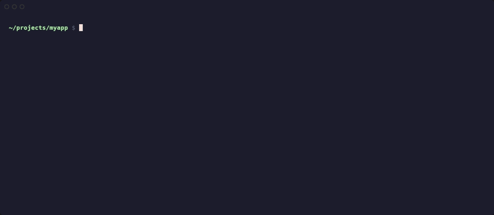

# Gru

[](https://github.com/fotoetienne/gru/actions/workflows/ci.yml)
[](https://github.com/fotoetienne/gru/blob/main/LICENSE)

**File a GitHub issue. Gru turns it into a merged PR.**

Gru Lab is a local daemon that watches your repos for issues labeled `gru:todo`. For each one it spawns a Minion, a coding agent in its own git worktree, which implements the change, opens a PR, fixes CI failures, answers review comments, and rebases until the PR is ready to merge. You stay in GitHub, or in whatever LLM session you were already using to think through the work.



Gru is **agent-agnostic**. It ships with backends for [Claude Code](https://github.com/anthropics/claude-code), [OpenAI Codex](https://github.com/openai/codex), and [Pi](https://github.com/earendil-works/pi-mono), and its pluggable architecture makes it straightforward to add more.

## The Workflow

1. **Talk it through.** Work out the problem in a chat with Claude Code, Codex, or any agent that can run `gh`.
2. **File issues.** Ask the agent to file one or more GitHub issues labeled `gru:todo`. For multi-step work, ask it to set blocked-by relationships so Minions pick the issues up in order.
3. **Let the Lab run.** `gru lab` claims each unblocked issue and works it to a PR. When a PR merges and closes its issue, the next issue in the chain becomes eligible.

## What a Minion Does

Each issue gets its own Minion, which carries the work from issue to merge:

- **Implements and tests** the change in an isolated git worktree, so your own checkout is never touched
- **Reviews its own work** with a code-reviewer subagent before opening the PR, then posts a review on the PR and addresses what it finds
- **Fixes CI failures** by feeding the logs back to the agent (up to 2 attempts before escalating)
- **Responds to review comments** from you or anyone else on the PR
- **Rebases and resolves merge conflicts** when the base branch moves
- **Merges** when the PR is labeled `gru:auto-merge` and an LLM merge judge decides it's safe; otherwise it waits for you

## Quick Start

```bash
# Install prebuilt binary (macOS Apple Silicon)
curl -fL https://github.com/fotoetienne/gru/releases/latest/download/gru-aarch64-apple-darwin.tar.gz | tar xz
sudo mv gru /usr/local/bin/

# Or install from crates.io (all platforms, requires Rust 1.73+)
cargo install gru

# Initialize a repo: creates a bare mirror and the gru:* labels
gru init owner/repo

# Start the Lab
gru lab --repos owner/repo
```

Then hand it work: ask your agent to file an issue labeled `gru:todo`, or add the label to an existing issue in GitHub.

Prebuilt binaries for macOS x86_64 and Linux are on the [Releases page](https://github.com/fotoetienne/gru/releases/latest).

For a full walkthrough, see [Getting Started](GETTING_STARTED.md).

## How It Works

1. `gru init owner/repo` creates a bare git mirror at `~/.gru/repos/` and the `gru:*` labels
2. `gru lab` polls for `gru:todo` issues, skips any with open blockers, and claims the rest
3. Each Minion gets an isolated worktree under `~/.gru/work/`, so your own checkout is never touched
4. The agent reads the issue, explores the code, makes changes, and runs tests
5. After committing, a code-reviewer subagent checks for correctness, security, and convention issues before the PR is created
6. Gru opens a PR, watches CI, and feeds failures back to the agent for auto-fix (up to 2 attempts before escalating)
7. Review comments and merge conflicts wake the Minion to respond or rebase
8. With `gru:auto-merge`, the monitoring Minion asks an LLM merge judge whether the PR is safe to merge; otherwise it waits for you
9. Labels track state on GitHub: `gru:in-progress` while the Minion works, `gru:done` once the PR is open, `gru:failed` or `gru:blocked` when it needs help

To run one issue in the foreground without the Lab, use `gru do 42`.

## Links

- [GitHub Repository](https://github.com/fotoetienne/gru)
- [Releases](https://github.com/fotoetienne/gru/releases/latest)
- [Contributing](https://github.com/fotoetienne/gru/blob/main/CONTRIBUTING.md)
- [License: Apache 2.0](https://github.com/fotoetienne/gru/blob/main/LICENSE)
